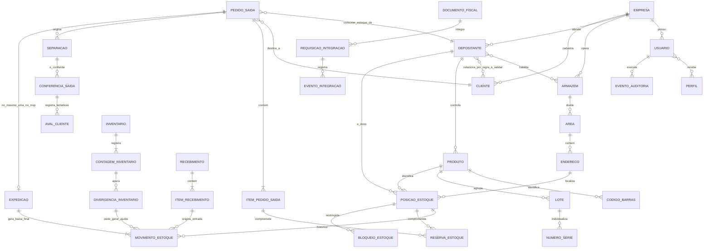

# Modelo lógico e conceitual

Este documento apresenta um esboço inicial do modelo de dados do **Estoque Mais**, coerente com [[Decisões vigentes]], [[Esboço - Visão do Produto]], [[Requisitos]] e [[Implementação técnica]]. Ele não representa ainda o esquema definitivo do banco.

## Premissas vigentes

- O produto é um WMS mobile-first para pequenos e médios operadores logísticos 3PL.
- **Empresa** representa o operador logístico que utiliza o sistema; **depositante** identifica a responsabilidade e a segregação do estoque.
- **Cliente** é distinto do depositante e identifica o destinatário e participante da conferência da saída; a mesma pessoa jurídica pode exercer ambos os papéis, registrados separadamente por operação.
- Um depositante pode operar em vários armazéns por associação explícita.
- O lote é obrigatório por padrão; exceção depende de regra de negócio explícita. Produto serializado sempre exige lote.
- `movimento_estoque` é o histórico imutável; `saldo_estoque` é a projeção transacional do estado físico atual.
- No fluxo inicial, o aval do cliente aprova a conferência e é pré-condição operacional da expedição. **A baixa física ocorre uma única vez na conclusão da expedição**, pela quantidade efetivamente expedida.
- Regras de autorização podem variar por fluxo. A integração fiscal é separada da aprovação operacional e do movimento físico.

## 1. Modelo conceitual

### 1.1 Escopo e termos do domínio

Este capítulo descreve os conceitos e regras de negócio. O capítulo 2 registra sua representação lógica inicial. Decisões confirmadas são diferenciadas de propostas ainda a validar.

#### Organização, participantes e responsabilidade sobre o estoque

- **Empresa operadora:** o 3PL que usa o sistema e responde pela execução nos armazéns.
- **Armazém:** instalação operada pela empresa, organizada em áreas e endereços, habilitada para depositantes.
- **Depositante:** parte responsável pelo estoque armazenado; define a propriedade e segregação do saldo no MVP.
- **Cliente:** parte relacionada a uma saída, normalmente destinatária e participante da conferência. Não é presumido como dono do estoque.
- **Usuário e perfil:** identificam quem executa/aprova ações e os limites de acesso.

Cliente e depositante são papéis distintos, mesmo quando exercidos pela mesma pessoa jurídica. Recebimentos identificam o depositante; pedidos de saída identificam explicitamente depositante e cliente. Um papel nunca é inferido a partir do outro.

**Decisão vigente:** a relação depositante-cliente é N:M por associação ativa/inativa explícita. Cada pedido referencia exatamente um depositante e um cliente e valida o par ativo. No MVP, não há restrição adicional por armazém, contrato ou produto.

#### Catálogo e rastreabilidade

- **Produto:** item controlado, pertencente a um depositante, com unidade e política de rastreabilidade.
- **Código de barras:** identificador de produto ou unidade logística conforme tipo cadastrado.
- **Lote:** agrupamento rastreável de unidades; obrigatório por padrão e dispensável somente por regra explícita.
- **Número de série:** identifica unidade individual e sempre pertence a produto e lote.

#### Estrutura física

- **Área:** subdivisão operacional, como recebimento, armazenagem, separação e expedição.
- **Endereço:** posição identificada cuja situação/capacidade determina se pode receber estoque.
- **Área de separação/expedição:** localização temporária da mercadoria coletada antes de sair fisicamente.

#### Estoque, compromisso e histórico

- **Posição de estoque:** quantidade física por empresa, depositante, produto, armazém, endereço, lote/série e condição.
- **Reserva:** compromisso para um pedido; reduz disponibilidade, não o físico.
- **Bloqueio:** restrição rastreável que torna uma quantidade indisponível, com motivo e estado.
- **Separação:** alocação e movimentação operacional da quantidade reservada; ela continua no estoque até expedição.
- **Movimento de estoque:** evento imutável de mudança física ou ajuste de quantidade/local/condição. Reserva e aval não são movimentos de saída.
- **Saldo:** projeção atual derivada dos movimentos e compromissos ativos; não substitui histórico.

Regra do MVP: `disponível = físico - reserva_ativa - bloqueio`. Para bloquear quantidade reservada, liberar/cancelar a reserva com registro antes; assim as parcelas não se sobrepõem e não há dupla dedução. Saldo físico negativo não é permitido.

#### Operações e aprovações

- **Recebimento:** registra previsto, recebido e divergências. Entrada confirmada gera movimento para endereço de recebimento; putaway gera transferência posterior.
- **Pedido de saída:** demanda de estoque de um depositante destinada a um cliente.
- **Conferência de saída:** compara itens/quantidades separados com o pedido.
- **Aval do cliente:** decisão registrada sobre a conferência. No fluxo inicial é pré-condição operacional para expedir, mas não baixa o saldo.
- **Expedição:** confirmação final da saída física. Ao concluir, baixa uma vez a quantidade efetivamente expedida e consome ou libera as reservas.
- **Inventário:** contagem cuja divergência não altera saldo até um ajuste autorizado ser registrado como novo movimento.
- **Devolução:** nova entrada referenciada à operação original; nunca reversão silenciosa.

#### Auditoria e integração

Evento de auditoria registra ação, usuário, horário, objeto, motivo e decisão. Documento fiscal e integração (incluindo FocusNFe) são conceitos separados do aval operacional e do movimento físico; integração não gera baixa por si só.

### 1.2 Relacionamentos principais

#### Cardinalidades e recomendação para o MVP

| Relação | Cardinalidade conceitual | Estado |
|---|---|---|
| Empresa–usuários, armazéns, depositantes e clientes | 1:N | Estrutura do modelo |
| Usuários–perfis e perfis–permissões | N:M | Estrutura do modelo |
| Depositantes–armazéns | N:M por associação explícita | Vigente; associação já prevista |
| Depositantes–clientes | N:M por associação ativa/inativa | Confirmado; par validado por pedido, sem escopo adicional no MVP |
| Depositante–produtos | 1:N | Vigente no modelo |
| Produto–códigos de barras e produto–lotes | 1:N | Estrutura do modelo; regras de unicidade ainda precisam ser fechadas |
| Lote–números de série | 1:N; cada série pertence a um lote | Vigente |
| Armazém–áreas e área–endereços | 1:N em cada relação | Estrutura do modelo |
| Pedido de saída–depositante e pedido–cliente | N:1 em cada relação; exatamente um de cada por pedido no MVP | Confirmado |
| Pedido–itens e item–reservas | 1:N em cada relação | Estrutura do modelo |
| Pedido–expedição concluída | 1:0..1 no MVP rígido, sem expedição parcial | Decorre da decisão de expedir o pedido integralmente |
| Conferência–avaliações do cliente | 1:N tentativas registradas; no máximo uma aprovação vigente | Recomendação para preservar recusas e reavaliações no histórico |
| Inventário–contagens | 1:N | Estrutura do modelo |

**Recomendação principal:** adotar N:M entre depositantes e clientes, com associação ativa validada no pedido, e manter exatamente um depositante e um cliente por pedido no MVP. Se o negócio garantir que cada cliente pertence a um único depositante, isso pode ser reduzido para 1:N; a documentação atual não confirma essa restrição.

Cliente e depositante são registros separados mesmo quando compartilham a pessoa jurídica. Cada registro mantém seu próprio identificador e atributos do papel. O documento jurídico pode coincidir; não fundir cadastros nem compartilhar saldos, permissões ou históricos por causa dessa coincidência.

### 1.3 Regras de negócio do estoque

#### Identidade e propriedade

1. Toda posição pertence a uma empresa operadora e exatamente um depositante.
2. Produto/lote/série movimentados são compatíveis com depositante, armazém e endereços usados.
3. Operações exigem vínculos depositante-cliente e depositante-armazém ativos, quando a associação for adotada como controle.
4. Produto serializado exige conciliação entre quantidade e séries informadas.

#### Quantidades, disponibilidade e reserva

5. Físico, reservado, bloqueado, separado e expedido são medidas distintas; uma unidade não pode estar em duas parcelas de indisponibilidade.
6. Reserva compromete estoque elegível atomicamente; reservas ativas não excedem a disponibilidade, inclusive sob concorrência.
7. Bloqueio retira quantidade da disponibilidade e registra motivo, autor, horário e aprovador quando exigido. Para bloquear quantidade reservada, primeiro cancelar/liberar a reserva e registrar a ação.
8. Estoque em separação permanece físico e vinculado ao pedido; não pode ser reservado novamente nem contado como disponível.
9. **Não permitir saldo físico negativo no MVP; não há exceção operacional.**

#### Recebimento, movimentação e saída

10. Recebimento distingue previsto e recebido; divergência não sobrescreve o previsto.
11. Transferência conserva quantidade total do depositante e registra origem/destino na mesma operação lógica.
12. Conferência e aval não reduzem saldo físico.
13. No fluxo inicial, expedição física concluída gera a baixa única da quantidade efetivamente expedida. Aval aprovado é pré-condição operacional, não evento de baixa.
14. **Não permitir expedição parcial no MVP.** Pedido só é expedido integralmente; cancelamento antes da expedição libera reservas com histórico.
15. Repetir tecnicamente a confirmação da expedição não cria baixa duplicada.
16. Recusa de aval, divergência ou cancelamento impedem conclusão até tratamento autorizado.

#### Inventário, correção e histórico

17. Contagem registra quantidade observada, escopo, horário e contador. Toda divergência exige recontagem antes da decisão de ajuste.
18. Todo ajuste de saldo exige justificativa e aprovação de supervisor; ajuste é movimento separado.
19. Correção de operação concluída é estorno/compensação rastreável, nunca edição ou exclusão do movimento original.
20. Devolução cria entrada vinculada à expedição original e permanece indisponível até inspeção; após inspeção, classificar como disponível ou em condição não utilizável.

### 1.4 Fluxos conceituais

#### Entrada
`recebimento esperado → conferência física → entrada no endereço de recebimento → putaway por transferência → saldo armazenado`

#### Saída inicial
`pedido do depositante para cliente → validação de vínculo e saldo → reserva → separação → conferência → aval do cliente → expedição física concluída → baixa e consumo da reserva`

O aval é necessário no fluxo inicial. A baixa ocorre no evento final de expedição e corresponde à quantidade expedida. Integração fiscal, se aplicável, mantém estados próprios.

#### Inventário e ajuste
`escopo → contagem → recontagem se exigida → divergência → decisão/aprovação → movimento de ajuste → saldo reconciliado`

Aprovação obrigatória, tolerâncias e alçadas continuam a validar.

## 2. Modelo lógico inicial

### 2.1 Organização e controle de acesso

| Entidade | Campos principais | Regras iniciais |
|---|---|---|
| `empresa` | `id` PK, `razao_social`, `nome_fantasia`, `cnpj`, `status`, timestamps | `cnpj` único por empresa ativa |
| `usuario` | `id` PK, `empresa_id` FK, `nome`, `email`, `senha_hash`, `status`, timestamps | `email` único no escopo da empresa |
| `perfil` | `id` PK, `empresa_id` FK, `nome`, `descricao` | perfis configuráveis por empresa |
| `permissao` | `id` PK, `codigo`, `descricao` | `codigo` único no sistema |
| `usuario_perfil` | `usuario_id` FK, `perfil_id` FK | PK composta |
| `perfil_permissao` | `perfil_id` FK, `permissao_id` FK | PK composta |
| `usuario_depositante` | `usuario_id` FK, `depositante_id` FK, estado e timestamps de concessão/revogação | associação N:M obrigatória para escopo operacional; acesso negado por padrão sem vínculo ativo; acesso a todos os depositantes exige permissão explícita de escopo empresa |

### 2.2 Clientes, depositantes e catálogo

| Entidade | Campos principais | Regras iniciais |
|---|---|---|
| `cliente` | `id` PK, `empresa_id` FK, `razao_social`, `nome_fantasia`, `documento`, `status`, timestamps | entidade independente do depositante |
| `depositante` | `id` PK, `empresa_id` FK, `razao_social`, `nome_fantasia`, `documento`, `status`, timestamps | documento único no escopo da empresa |
| `depositante_cliente` | `depositante_id` FK, `cliente_id` FK, `status` ativo/inativo | associação N:M confirmada; pedidos validam o par ativo, sem restrição adicional no MVP |
| `produto` | `id` PK, `empresa_id` FK, `depositante_id` FK, `sku`, `descricao`, `unidade_medida`, `lote_obrigatorio`, `regra_excecao_lote`, `controla_serie`, `status` | exceção ao lote definida por produto com motivo e responsável; `controla_serie = true` exige lote |
| `codigo_barras` | `id` PK, `produto_id` FK, `codigo`, `tipo`, `principal` | código único por depositante; o mesmo código pode existir em depositantes diferentes e é resolvido pelo contexto ativo |
| `lote` | `id` PK, `produto_id` FK, `codigo`, `fabricado_em`, `valido_ate`, `status` | código único por produto e depositante |
| `numero_serie` | `id` PK, `produto_id` FK, `lote_id` FK obrigatório, `codigo`, `status` | todo número de série pertence a um lote; código único por produto e depositante |

### 2.3 Estrutura do armazém

| Entidade | Campos principais | Regras iniciais |
|---|---|---|
| `armazem` | `id` PK, `empresa_id` FK, `codigo`, `nome`, `status` | código único por empresa |
| `depositante_armazem` | `depositante_id` FK, `armazem_id` FK, `status`, `inicio_operacao`, `fim_operacao`? | permite ao depositante operar vários armazéns |
| `area` | `id` PK, `armazem_id` FK, `codigo`, `nome`, `tipo` | tipos controlados por enumeração ou tabela de domínio |
| `endereco` | `id` PK, `area_id` FK, `codigo`, `tipo`, `capacidade`, `unidade_capacidade`, `status` | código único por armazém |
### 2.4 Núcleo de estoque

| Entidade | Campos conceituais principais | Regras iniciais |
|---|---|---|
| `saldo_estoque` | empresa, depositante, armazém, endereço, produto, lote/série quando aplicáveis, condição, quantidade física e versão | projeção atual; lote obrigatório por padrão; condição não duplica reservas ou bloqueios |
| `reserva_estoque` | posição, item do pedido, quantidade, estado, autor e timestamps | compromete disponibilidade sem reduzir o físico; só reservas ativas entram no cálculo |
| `bloqueio_estoque` | posição, quantidade, motivo, estado, autor, aprovador e vigência | bloqueio rastreável; para bloquear quantidade reservada, cancelar/liberar a reserva antes |
| `movimento_estoque` | dimensões da posição, tipo, quantidade, origem/destino, operação de origem, motivo, usuário, horário e chave de idempotência | imutável; entrada, saída, transferência, ajuste e devolução; baixa final referencia a expedição |

Chave conceitual da posição: `empresa + depositante + armazém + endereço + produto + lote (ou exceção) + série quando unitário + condição`.

Regra do MVP: `disponível = físico - reserva_ativa - bloqueio`. A regra de bloqueio libera a reserva antes de retirar quantidade do disponível, portanto as parcelas não se sobrepõem. O saldo físico nunca pode ficar negativo.

Reserva não é movimento físico. Separação pode mudar endereço e estado operacional, mas não reduz o físico. A baixa de saída ocorre uma vez, quando a expedição integral é concluída.

`em_separacao` permanece estado operacional; a representação física (condição da posição ou estado da alocação de separação) ainda precisa ser escolhida no desenho lógico/físico.

### 2.5 Recebimento

| Entidade | Campos principais | Regras iniciais |
|---|---|---|
| `recebimento` | `id` PK, `empresa_id` FK, `depositante_id` FK, `armazem_id` FK, `referencia_externa`, `status`, `previsto_em`, `iniciado_em`, `concluido_em` | o depositante deve estar habilitado no armazém; referência externa idempotente por depositante ? |
| `item_recebimento` | `id` PK, `recebimento_id` FK, `produto_id` FK, `quantidade_prevista`, `quantidade_recebida`, `lote_id` FK?, `regra_excecao_lote_id` FK?, `validade`?, `status` | lote obrigatório por padrão; ausência exige regra de negócio registrada |
| `conferencia_recebimento` | `id` PK, `item_recebimento_id` FK, `usuario_id` FK, `quantidade`, `resultado`, `conferido_em` | preserva cada conferência; produto serializado exige lote e séries correspondentes |

Estados iniciais: `rascunho`, `aguardando`, `em_conferencia`, `com_divergencia`, `concluido`, `cancelado`.
### 2.6 Saída, separação e expedição

| Entidade | Campos conceituais principais | Regras iniciais |
|---|---|---|
| `pedido_saida` | empresa, depositante, cliente destinatário, armazém, referência, estado, prioridade e timestamps | identifica explicitamente dono do estoque e destinatário; valida vínculos ativos |
| `item_pedido_saida` | produto, quantidade solicitada, reservada, separada, aprovada na conferência e expedida | quantidades distintas e reconciliáveis; no MVP, a quantidade expedida deve igualar a quantidade do pedido aprovada |
| `separacao` | pedido, responsável, estado e timestamps | associa tarefas e reservas; mercadoria permanece no estoque físico até expedição |
| `item_separacao` | reserva, origem, destino/área de separação, quantidade, lote/série | não pode exceder reserva; preserva rastreabilidade por unidade |
| `conferencia_saida` | pedido/separação, usuário, quantidade conferida, resultado, horário | registra resultado e divergências; não movimenta nem baixa estoque |
| `aval_cliente` | conferência, cliente que avalia, decisão, escopo aprovado, representante, horário e evidência opcional | no fluxo inicial é pré-condição para expedição; não é evento fiscal nem movimento de baixa |
| `expedicao` | pedido, estado, quantidade expedida por item, responsável e horário de conclusão | no MVP, uma expedição integral por pedido; conclusão gera movimento de saída idempotente e consome as reservas |

Estados candidatos do pedido: `rascunho`, `aprovado`, `reservado`, `em_separacao`, `em_conferencia`, `aguardando_aval_cliente`, `aprovado_para_expedicao`, `em_expedicao`, `expedido`, `cancelado`. `expedido` significa saída física concluída e baixa registrada. Expedição parcial não é permitida no MVP.

A transição para `expedido` grava movimento de saída e atualiza a posição na mesma operação transacional. Uma chave de idempotência impede duplicidade em retries. Cancelamento antes da expedição libera as reservas com histórico. Depois da baixa física, não há cancelamento: registra-se devolução vinculada à expedição; a quantidade devolvida permanece indisponível até inspeção e aprovação do supervisor.

### 2.7 Inventário e ajustes

| Entidade | Campos principais | Regras iniciais |
|---|---|---|
| `inventario` | `id` PK, `empresa_id` FK, `armazem_id` FK, `depositante_id` FK?, `tipo`, `status`, timestamps | pode ser geral, por endereço, produto ou depositante |
| `contagem_inventario` | `id` PK, `inventario_id` FK, dimensões do saldo, `numero_contagem`, `quantidade_contada`, `usuario_id` FK, `contado_em` | preserva contagens e recontagens; toda divergência exige recontagem antes de decidir ajuste |
| `divergencia_inventario` | `id` PK, `contagem_id` FK, `quantidade_sistema`, `quantidade_contada`, `diferenca`, `status`, `motivo` | não ajusta saldo automaticamente; permanece até decisão registrada |
| `aprovacao_ajuste` | `id` PK, `divergencia_id` FK, `aprovador_id` FK, `decisao`, `justificativa`, `decidido_em` | todo ajuste exige aprovação de supervisor |

O ajuste aprovado gera movimento separado; não sobrescreve a posição nem apaga a contagem que originou a divergência.
No início do inventário, capturar snapshot/versionamento das posições e quantidades contadas. Movimentos ocorridos após o corte são preservados e reconciliados contra o snapshot antes de qualquer ajuste, sem apagar eventos concorrentes.

### 2.8 Auditoria e integração fiscal

| Entidade | Campos conceituais principais | Regras iniciais |
|---|---|---|
| `evento_auditoria` | empresa, usuário, ação, entidade, dados relevantes anteriores/novos, motivo, horário | append-only; registrar decisões e operações críticas sem guardar segredos desnecessários |
| `documento_fiscal` | empresa, depositante, cliente quando aplicável, operação relacionada, tipo, chave/número/série, estado | vínculo fiscal separado do pedido e do movimento físico |
| `requisicao_integracao` | empresa, provedor, operação, chave de idempotência, estado, tentativas e horários | credenciais fora do payload e protegidas no back-end |
| `evento_integracao` | requisição, resposta/erro, código, mensagem segura e horário | histórico de envio, retorno, reprocessamento e reconciliação |

O aval do cliente é uma decisão operacional de conferência. A FocusNFe e os documentos fiscais geram estados de integração próprios. A baixa inicial decorre da expedição física concluída; eventos fiscais não devem criar, antecipar nem duplicar essa baixa. Regras de autorização podem variar em outros fluxos, a especificar separadamente.

## 3. Regras transversais

- Toda operação de estoque pertence a uma empresa e a um depositante; isolamento e autorização são validados em cada leitura e escrita.
- Produto, lote, série, armazém e endereços usados precisam ser compatíveis com o depositante e estar ativos para o fluxo.
- Movimento e atualização do saldo são atômicos. Falha em qualquer parte não pode deixar saldo e histórico divergentes.
- Atualizações concorrentes devem impedir sobre-reserva e baixa duplicada; estratégia técnica (bloqueio ou controle de versão) ainda será escolhida.
- Movimentos e decisões concluídos são imutáveis; correções geram eventos compensatórios rastreáveis.
- Quantidades usam unidade e precisão compatíveis com o produto; conversões devem ser explícitas e auditáveis.
- Confirmações repetidas de recebimento, ajuste e expedição devem ser idempotentes.
- Eventos FocusNFe e falhas de integração não alteram estoque sem regra explícita do fluxo correspondente.
- Datas operacionais preservam instante e contexto de fuso; auditoria inclui ator e horário.
- Política de retenção, acesso administrativo e proteção contra alteração direta da auditoria ainda precisam ser definidas.

## 4. Decisões ainda abertas

### Regras e condições de estoque

- Quais motivos e evidências serão padronizados para bloqueio, desbloqueio, cancelamento, devolução e recusa do aval? Para bloqueio por avaria, validade ou inspeção, definir lista controlada e dados obrigatórios.
- Quais tolerâncias operacionais se aplicam a peso, capacidade e divergências fiscais? Usar valores documentados, sem inferir limites genéricos.

### Depositantes, clientes e acesso

#### Decisões confirmadas

- Depositante-cliente é N:M, por associação ativa/inativa; cada pedido referencia exatamente um de cada e exige vínculo ativo.
- A desativação da associação cliente-depositante exige aprovação de supervisor; o tratamento dos pedidos já em andamento permanece pendente.
- O vínculo não tem escopo adicional por armazém, contrato ou produto no MVP.
- Cliente e depositante permanecem cadastros separados mesmo quando compartilham a pessoa jurídica.
- O acesso é concedido por perfil e depositante e negado por padrão; escopo de empresa é explícito para administrador e auditado.
- Não há portal externo de cliente/depositante no MVP.
- O supervisor cadastra os representantes autorizados dos clientes.
- O aval é registrado internamente pelo conferente, com representante, decisão e data/hora. A evidência aceita pode ser e-mail, assinatura ou documento anexado; o conferente transcreve a decisão, sem decidir pelo cliente.

#### Matriz de permissões aprovada para o MVP

| Perfil | Permissões e limites |
|---|---|
| Administrador da empresa | Gerencia usuários, perfis, cadastros e configurações. Acesso amplo somente com concessão explícita de escopo empresa; ações administrativas são auditadas. Aprova bloqueios ou ajustes apenas se também tiver papel de supervisor. |
| Supervisor | Opera os depositantes associados, distribui tarefas, aprova bloqueios e ajustes e cadastra representantes autorizados. Não aprova a própria solicitação. |
| Operador | Executa tarefas atribuídas de recebimento, armazenagem, movimentação e picking; solicita bloqueios e registra ocorrências. Não aprova ajustes, bloqueios ou aval em nome do cliente. |
| Conferente | Registra conferências e divergências, transcreve a decisão do representante autorizado e anexa a evidência. Não decide pelo cliente nem aprova ajustes. |
| Auditor | Leitura somente nos depositantes atribuídos, incluindo operações, aprovações e evidências; sem movimentação ou aprovação. |
| Cliente/depositante externo | Sem conta ou portal no MVP. |

A autorização deve ser verificada em cada consulta e operação pelo vínculo ativo `usuario_depositante`, salvo escopo de empresa explicitamente concedido ao administrador.

#### Decisões operacionais ainda necessárias

- Definir como o supervisor confirma e registra a autorização do representante e controla sua vigência ou substituição.
- Definir o tratamento dos pedidos em andamento após a aprovação e efetivação da desativação do vínculo cliente-depositante.

### Inventário e migração — execução

- Identificar sistema/arquivos de origem, responsável, leiaute, volume e qualidade dos dados.
- Mapear chaves e campos de origem para depositante, cliente, produto/SKU, endereço, lote/série e saldo; definir como corrigir ou rejeitar linhas inválidas.
- Marcar data/hora de corte e controlar movimentos entre extração, ensaio e go-live para evitar duplicidade.
- Confirmar o formato e o local de arquivamento da origem e das evidências de reconciliação.
- Preparar cenários de ensaio, critérios de aceitação das diferenças e procedimento de rollback.

### Operação e infraestrutura

- Identificar aparelhos, versões, servidor, rede e armazenamento separado já disponíveis; medir cobertura e carga representativa para a matriz de homologação.
- Definir retenção de backup, RPO, RTO e responsáveis do cliente; validar a rotina de restauração e o acesso à cópia separada.
- Definir política de expiração e limpeza de rascunhos locais não confirmados.

### Integração fiscal

- A consulta aprovada é de CT-e emitido pela FocusNFe, usando a referência do documento. Emissão, cancelamento e consulta de CT-e recebido ficam fora do primeiro escopo.
- Mapear os estados fiscais do provedor para estados internos, preservando o status original e os detalhes SEFAZ disponíveis. Tratar falha técnica de consulta separadamente da situação fiscal; definir tentativas, reconciliação e retenção.
- Confirmar por fluxo se algum estado fiscal será pré-condição para expedir. Até essa validação, o estado fiscal não bloqueia expedição e não altera aval nem baixa física.

### Validação do MVP

- Quais cenários e métricas do piloto confirmarão que as regras atendem à operação sem criar retrabalho ou bloquear expedições indevidamente?
## 5. Próximo passo recomendado

Validar o modelo com cenários do piloto: **recebimento com divergência**, **reserva concorrente do mesmo saldo**, **bloqueio de quantidade já reservada**, **saída com aval e baixa ao concluir a expedição**, **cancelamento/quantidade não expedida**, **inventário com ajuste aprovado** e **devolução após expedição**. Para cada cenário, registrar ator, pré-condições, transições, parcelas de quantidade, movimentos, aprovações e resultado esperado. Depois, consolidar decisões aprovadas no modelo lógico e derivar esquema físico e contratos de API.