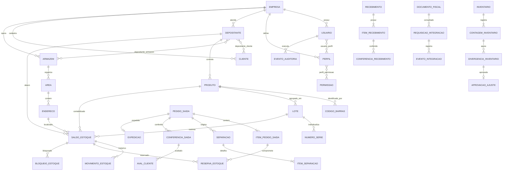

# Modelo lógico relacional — Estoque Mais

**Versão:** 0.1 — derivação inicial  
**Base:** modelo conceitual do projeto e diagrama conceitual enviado pelo usuário.  
**Estado:** proposta para validação; não homologada para produção.

## Critérios de transformação

O modelo lógico converte entidades em tabelas, atributos em colunas, identificadores em chaves primárias e relacionamentos em chaves estrangeiras. Relacionamentos N:M viram tabelas associativas. Histórico de movimentos e auditoria é mantido separado das projeções de saldo.

O modelo respeita as decisões documentadas: empresa operadora separada de depositante e cliente; depositante-cliente N:M; depositante-armazém N:M; pedido ligado a um único depositante e um cliente; lote obrigatório por padrão, com exceção explícita; recebimento não apaga divergência; conferência do pedido ocorre junto ao cliente; aval não reduz saldo; baixa ocorre uma única vez na expedição concluída; inventário divergente só altera saldo por ajuste aprovado.

## Diagrama lógico

## Relações e chaves

| Tabela | PK | FKs principais | Cardinalidade / restrição |
|---|---|---|---|
| `empresa` | `id_empresa` | — | Operadora 1:N usuários, perfis, armazéns, depositantes e clientes. |
| `usuario` | `id_usuario` | `empresa_id` | Empresa 1:N usuários; e-mail único por empresa. |
| `perfil` | `id_perfil` | `empresa_id` | Perfis pertencem à empresa. |
| `permissao` | `id_permissao` | — | Código de permissão único. |
| `usuario_perfil` | PK composta | usuário, perfil | Resolve N:M usuário-perfil. |
| `perfil_permissao` | PK composta | perfil, permissão | Resolve N:M perfil-permissão. |
| `depositante` | `id_depositante` | `empresa_id` | Estoque segregado por depositante. |
| `cliente` | `id_cliente` | `empresa_id` | Cadastro distinto de depositante. |
| `depositante_cliente` | PK composta | depositante, cliente | Associação N:M, com estado ativo/inativo. |
| `armazem` | `id_armazem` | `empresa_id` | Armazém operado por uma empresa. |
| `depositante_armazem` | PK composta | depositante, armazém | Associação N:M explícita. |
| `area` | `id_area` | `armazem_id` | Armazém 1:N áreas. |
| `endereco` | `id_endereco` | `area_id` | Área 1:N endereços. |
| `produto` | `id_produto` | empresa, depositante | SKU no escopo do depositante; lote por padrão. |
| `codigo_barras` | `id_codigo_barras` | produto | Produto 1:N códigos; unicidade por depositante deve ser validada com contexto do produto. |
| `lote` | `id_lote` | produto | Produto 1:N lotes; código único por produto. |
| `numero_serie` | `id_numero_serie` | produto, lote | Número de série pertence a produto e lote; único por produto. |
| `recebimento` | `id_recebimento` | empresa, depositante, armazém | Recebimento 1:N itens. |
| `item_recebimento` | `id_item_recebimento` | recebimento, produto, lote | Previsto e recebido são armazenados separadamente. |
| `conferencia_recebimento` | `id_conferencia_recebimento` | item, usuário | Mantém tentativas/conferências e divergências. |
| `saldo_estoque` | `id_saldo` | empresa, depositante, endereço, produto, lote, série | Projeção por posição e condição; dimensão composta única. |
| `movimento_estoque` | `id_movimento` | saldo origem/destino, usuário | Histórico imutável; origem de negócio é registrada como referência tipada. |
| `pedido_saida` | `id_pedido_saida` | empresa, depositante, cliente, armazém | Exatamente um depositante e um cliente por pedido. |
| `item_pedido_saida` | `id_item_pedido` | pedido, produto | Pedido 1:N itens. |
| `reserva_estoque` | `id_reserva` | saldo, item do pedido, usuário | Reserva afeta disponibilidade, não saldo físico. |
| `bloqueio_estoque` | `id_bloqueio` | saldo, usuário solicitante/aprovador | Quantidade indisponível com motivo e histórico. |
| `separacao` | `id_separacao` | pedido, usuário | Pedido pode ter tarefas de separação. |
| `item_separacao` | `id_item_separacao` | separação, reserva, endereços | Mantém origem/destino e quantidade separada. |
| `conferencia_saida` | `id_conferencia_saida` | pedido, usuário conferente | Confere itens sem baixar fisicamente. |
| `aval_cliente` | `id_aval` | conferência, cliente, representante | Registra a decisão tomada junto ao cliente e evidência. |
| `expedicao` | `id_expedicao` | pedido, usuário | No máximo uma conclusão integral por pedido no MVP. |
| `inventario` | `id_inventario` | empresa, armazém, depositante opcional | Inventário 1:N contagens. |
| `contagem_inventario` | `id_contagem` | inventário, saldo, usuário | Preserva primeira contagem e recontagens. |
| `divergencia_inventario` | `id_divergencia` | contagem | Divergência não ajusta saldo automaticamente. |
| `aprovacao_ajuste` | `id_aprovacao` | divergência, aprovador | Uma decisão vinculada à divergência; ajuste aprovado gera movimento. |
| `evento_auditoria` | `id_evento_auditoria` | empresa, usuário | Registro append-only recomendado. |
| `documento_fiscal` | `id_documento_fiscal` | empresa, depositante, cliente opcional | Estado fiscal separado da expedição/aval. |
| `requisicao_integracao` | `id_requisicao` | documento fiscal | Tentativas idempotentes de consulta/operação. |
| `evento_integracao` | `id_evento_integracao` | requisição | Histórico de retorno/erro do provedor. |

## Integridade e normalização

1. Atributos de empresa, depositante, cliente e produto ficam em suas respectivas relações; as associações N:M são tabelas próprias.
2. Itens de recebimento, pedido e separação são separados de seus cabeçalhos, evitando grupos repetidos.
3. Quantidades prevista/recebida, solicitada/reservada/separada/expedida e contada são atributos distintos, pois representam fatos diferentes.
4. `saldo_estoque` é projeção mutável protegida por transação; `movimento_estoque` preserva o histórico imutável.
5. Reserva e bloqueio permanecem relações independentes e identificáveis para calcular disponibilidade sem sobrescrever o físico.
6. Chaves estrangeiras garantem existência referencial; consistência entre empresa, depositante, produto e armazém também exige validação transacional/serviço, ou FKs compostas após decisão de modelagem física.
7. Estados são `VARCHAR` nesta etapa para permitir evolução controlada; catálogo/enumeração e transições válidas precisam ser definidos antes do esquema final.
8. Senha só pode ser persistida como hash derivado de algoritmo apropriado; nunca armazenar senha em texto puro.

## Regras que precisam de decisão antes da versão física

- Estratégia de identificadores (`BIGINT`, UUID ou outra), collation e fuso horário.
- Unicidade global/local de CNPJ e documento para cliente/depositante.
- Política de exclusão lógica, retenção e acesso a auditoria.
- Como representar produto sem lote quando exceção estiver autorizada.
- Unicidade de saldo com lote/série opcionais no MySQL e política de posições vazias.
- Unidade de medida e escala de precisão para cada produto.
- Modelo para estoque em separação, contêineres/pallets e área temporária.
- Mapeamento dos vários tipos de origem do movimento e FKs para cada operação.
- A cardinalidade permitida para recontagens, aprovações e tentativas de aval.
- A evidência do aval: metadado, documento armazenado, hash, política de acesso/retensão.
- Transições válidas de estados e idempotência em recebimento, ajuste e expedição.
- Restrições reais de capacidade dos endereços conforme ficha técnica e validação no local.

## Arquivo DDL associado

O arquivo `database/schema/estoque_mais_v0_1.sql` contém um DDL MySQL inicial, subordinado a este modelo e igualmente não homologado. Ele deve ser revisado e executado somente em banco de desenvolvimento após confirmar a versão do MySQL e as decisões abertas.
